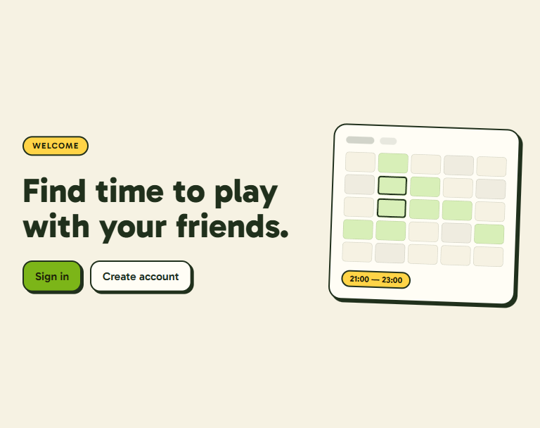
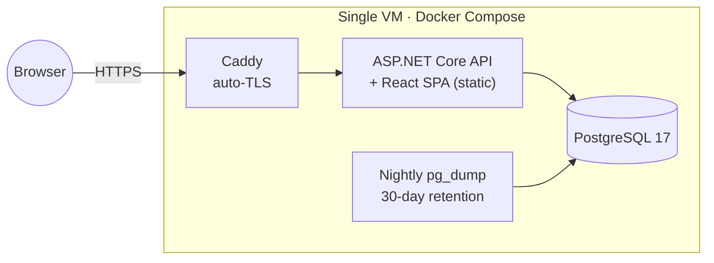

<div align="center">

# 🎮 PartyUp

**Stop asking *"so… when can everyone play?"* — start playing.**

[**partyup.social**](https://partyup.social)

[](https://github.com/Nilotaviano/PartyUpSocial/actions/workflows/ci.yml)
[](LICENSE)
[](https://dotnet.microsoft.com/)
[](https://react.dev/)
[](https://www.typescriptlang.org/)
[](https://www.postgresql.org/)

*Pre-launch · built in public · spec-first*

</div>

---

Every friend group has the same problem: five people, five schedules, one game everyone wants to play, and a group chat full of *"I can do Thursday… actually no, Friday?"* that ends with nobody playing anything.

PartyUp gives the whole friend group one place to **publish availability**, **propose sessions**, and **actually commit** — so the plan survives contact with real calendars.

<div align="center">
  <picture>
    <source media="(prefers-color-scheme: dark)" srcset="docs/assets/welcome-dark.png">
    
  </picture>
  <br>
  <sub>The "Tabletop Club" identity — cardstock &amp; ink in the light, club-green after dark. The picture follows your theme.</sub>
</div>

> 🚧 **Status:** the launch scope is built and live at [partyup.social](https://partyup.social) — sessions, availability, polls, friends & friend groups, notifications, three languages, and the full visual identity (light *and* dark, WCAG 2.2 AA with a zero-exclusion axe gate on every route in both themes). A few residual gaps are tracked in [TRACEABILITY.md](TRACEABILITY.md) (e.g. the D-111 calendar layer toggles aren't reachable in the UI yet). What remains is the launch itself: private beta, then a single full-scope public release. This repo is the real, working codebase — watch it grow.

## ✨ What it does (launch scope)

- 📅 **Fixed-time sessions** — title, game, platform, capacity; invitees RSVP Going / Maybe / Declined
- ✅ **Auto-confirmation** — a session confirms itself the moment enough people are Going, with waitlists, manual promotion, and carefully specified edge cases (capacity edits, start-time changes, mid-session joins)
- 🗳️ **Scheduling polls** — can't pick a time? Offer up to 12 candidate slots, let everyone vote Available / Maybe / Unavailable, finalize the winner into a real session with fair, first-come capacity allocation
- 🕒 **Availability sharing** — one-time or weekly blocks on a drag-and-drop week grid (with full keyboard access), merged and ranked into *"here's when you can all play"* recommendations
- 🔗 **Guest links** — friends without accounts RSVP or vote through a secure personal link; no signup wall
- 👥 **Real friend graph** — friend codes, QR codes, profile links, Steam friend-list import; blocking with mutual invisibility
- 🫂 **Friend groups** — name your squad once, then share sessions and polls with the whole group; membership changes propagate to what people can see, with clear provenance for *why* you can see something
- 🌍 **Timezone-correct by construction** — NodaTime end to end; weekly availability keeps its wall-clock time across DST transitions
- 🔔 **Web Push + in-app notifications** — invitations, confirmations, reminders, poll deadlines; per-session mute
- 🗣️ **Three languages** — English, Português (BR), Español, including notifications and emails
- ♿ **WCAG 2.2 AA target** — keyboard-first drag alternatives, screen-reader announcements, reduced-motion support

The complete behavior is specified before code in [PRODUCT_SPEC.md](PRODUCT_SPEC.md) — **225 numbered product decisions** (D-001…D-225), each one traceable to the test that proves it.

## 🏗️ How it's built



One deployable unit, boring on purpose. Behind that simplicity, the codebase is layered strictly:

```
Domain → nothing        pure C# state machines, visibility & overlap engines (NodaTime only)
Application → Domain    use cases, ports, domain events
Infrastructure → both   EF Core + Npgsql, migrations, integrations
Api → all three         composition root: minimal APIs, OpenAPI, health, SPA hosting
```

| Choice | Why |
|---|---|
| **ASP.NET Core (.NET 10) minimal APIs** | First-class OpenAPI; the API document *is* the future mobile contract |
| **PostgreSQL + EF Core + NodaTime** | `timestamptz ↔ Instant` mapping; scheduling apps live or die on time correctness |
| **React 19 + Vite + TypeScript (strict)** | Typed API client generated from the served OpenAPI document — no drift |
| **TanStack Query + Tailwind v4 + Radix** | Server state where it belongs; accessible primitives |
| **Cookie auth (BFF), same-origin** | SPA is served by the API container — no CORS, no token juggling |
| **Hangfire (in-process)** | Status transitions are materialized by an idempotent sweeper, never re-derived per query |
| **Docker Compose on one VM** | Sized honestly for friend-group scale; the load-test phase decides if that ever changes |

Engineering practices that keep it honest:

- 📋 **Spec-first, decisions on record** — product decisions (D-numbers) and architecture decisions ([A-001…A-020](ARCHITECTURE.md#9-decision-record-foundation)) are written down, numbered, and cited in code reviews and test names
- 🧪 **Tests named after the rules they prove** — domain tests carry decision IDs (`grep D_074` finds the waitlist-grace rule); integration tests run against real PostgreSQL via Testcontainers
- 🚦 **CI-gated CD** — a red build can never reach the server; images are immutably sha-tagged for one-command rollback
- 🔐 **Security as design input** — guest links are hashed bearer credentials (256-bit CSPRNG, never logged), visibility checks fail closed, deletion compliance survives database restores
- ⚠️ **Zero-warning builds** — `TreatWarningsAsErrors` + analyzers across every project

## 🚀 Getting started

Prereqs: **.NET SDK 10**, **Node 24+**, **Docker** (optional — local Postgres + integration tests; works fine [inside WSL](ARCHITECTURE.md#6-local-development-workflow)).

```sh
# once
dotnet tool restore
cd web && npm ci && cd ..

# database (or point ConnectionStrings__Db at any Postgres 17)
docker compose -f deploy/compose.dev.yml up -d
dotnet dotnet-ef database update --project src/PartyUp.Infrastructure --startup-project src/PartyUp.Api

# run
dotnet run --project src/PartyUp.Api     # API on :5000 (OpenAPI at /openapi/v1.json)
cd web && npm run dev                    # SPA on :5173, proxied to the API
```

On Windows, development Postgres and the integration-test Docker daemon live inside WSL, not on the Windows host. The WSL VM idles out and stops Docker/Postgres when nothing keeps it active, so keep a WSL shell open while running the API from a Windows terminal.

Development defaults `Email:Provider` to `log`. Rendered messages are logged and written as gitignored `.eml` files under `src/PartyUp.Api/mail-drop`; use those messages to follow local verification, recovery, magic-link and deletion flows.

OpenAPI client generation is a live-server operation: start `src/PartyUp.Api` first, then run `cd web && npm run gen:api`. The command reads the running API's `/openapi/v1.json`; it does not generate from source files alone.

Verify your setup:

```sh
dotnet build PartyUp.sln                                   # 0 warnings, or it doesn't ship
dotnet test PartyUp.sln --filter "Category!=Integration"   # unit tests (no Docker needed)
dotnet test PartyUp.sln                                    # + integration tests (real Postgres via Testcontainers)
cd web && npm run lint && npm run build && npm test
```

## Pre-push test gate

Pushing runs the **full test suite, integration tests included** — the repo rule
is that no push may skip them. The hook lives in `.githooks/pre-push` and is
versioned with the repo, but git only uses it after a one-time step per clone:

```sh
git config core.hooksPath .githooks
```

### What it does

- **Windows**: integration tests need Docker, which lives inside WSL, not on the
  host — the hook routes the run through WSL:
  `wsl -d Ubuntu-24.04 -e bash -lc "cd /mnt/c/<repo> && dotnet test PartyUp.sln -p:ArtifactsPath=/tmp/partyup-artifacts"`
  (the `ArtifactsPath` redirect keeps build output off the slow `/mnt/c` mount).

Run the same mandatory gate explicitly before a push when you want the result before the hook — `scripts/wsl-gate.sh` runs one build, then concurrent test shards mirroring CI's backend integration matrix (~3× faster than the serial run; CI's web and real-browser suites are separate jobs):

```sh
wsl -d Ubuntu-24.04 -e bash -lc 'cd /mnt/c/Users/nilot/source/repos/PartyUpSocial && scripts/wsl-gate.sh'
# serial fallback, identical coverage:
wsl -d Ubuntu-24.04 -e bash -lc 'cd /mnt/c/Users/nilot/source/repos/PartyUpSocial && dotnet test PartyUp.sln -p:ArtifactsPath=/tmp/partyup-artifacts'
```
- **Linux/macOS**: runs `dotnet test PartyUp.sln` directly and expects the
  .NET SDK plus a reachable Docker daemon (Testcontainers) on the host.

A failing test — or an unreachable WSL distro / Docker daemon — blocks the
push. That is intended: fix the environment or the tests, don't skip the gate.

### Prerequisites

- **Windows**: WSL distro `Ubuntu-24.04` with the .NET 10 SDK and Docker
  running inside it.
- **Linux/macOS**: .NET 10 SDK and a running Docker daemon.

The run takes a few minutes (2,000+ backend test methods across the unit and
integration lanes, integration against real Postgres via Testcontainers). The
~780 web tests and the real-browser lane run as separate CI jobs.

### Bypassing

Do not bypass the hook with `git push --no-verify`. The full WSL suite is a
mandatory pre-push gate; fix the environment or the tests before pushing.

## 📚 Documentation

| Document | What's inside |
|---|---|
| [PRODUCT_SPEC.md](PRODUCT_SPEC.md) | Full product behavior — 225 numbered, statused decisions |
| [DOMAIN_MODEL.md](DOMAIN_MODEL.md) | Ratified domain design — aggregates, state machines, visibility rules |
| [IMPLEMENTATION_PLAN.md](IMPLEMENTATION_PLAN.md) | Phased delivery plan with honest sizing |
| [ARCHITECTURE.md](ARCHITECTURE.md) | Technical foundation, conventions, decision record |
| [TRACEABILITY.md](TRACEABILITY.md) | Every decision mapped to the test that proves it |
| [deploy/](deploy/) | Dockerfile, compose files, Caddy config, backup & restore runbooks |

## 🗺️ Roadmap

| Phase | Scope | Status |
|---|---|---|
| 0 | Walking skeleton — CI/CD, deploy stack, health, migrations; spikes A/B/C decided (A-018..A-020) | ✅ |
| 1 | Domain core — session/poll state machines, visibility & overlap engines, D-number test suite (DOMAIN_MODEL.md + TRACEABILITY.md, 1033 tests) | ✅ |
| 2 | Accounts, auth (email, magic link, Google, Steam), onboarding, admin foundations, public deletion flow ([PHASE2_DESIGN.md](PHASE2_DESIGN.md)) | ✅ |
| 3 | Friends, blocking, Steam import | ✅ |
| 4 | Fixed-time sessions end-to-end, guest links | ✅ |
| 5 | Availability, recommendations, calendar views (+ 5.1 visual identity & dark mode) | ✅ |
| 6 | Scheduling polls | ✅ |
| 7 | Notification transports & preferences | ✅ |
| 8 | Localization, WCAG 2.2 AA audit, hardening, admin area | ✅ |
| 9 | Go-live infrastructure — VM, TLS, CI-gated auto-deploy (done 2026-07-30; rclone offsite + restore drill open) | ✅ |
| 10 | Friend groups — shared visibility circles with provenance | ✅ |
| — | Private beta → single full-scope public launch | ⬜ |

Everything ships together in one public v1 — no stripped-down beta ([D-163](PRODUCT_SPEC.md#14-decisions)).

### After launch

Roughly in order — each item gets its own spec pass (new D-numbers) before any code, so scope and order may shift:

1. **In-app feedback channel** — a low-friction way to tell us what's broken or missing, right from the app
2. **Polish sweep** — small tracked residuals: accessibility refinements, doc drift, translation review
3. **Session history** — a page for the sessions you've already played
4. **Email deliverability** — bounce/complaint webhook handling so notifications stay out of spam folders
5. **Shareable session cards** — link a session in Discord or WhatsApp and get a rich preview card
6. **Guest → account upgrade** — created RSVPs as a guest? Keep them when you sign up
7. **Referrals** — invite a friend with a personal link
8. **Discord integration** — session and poll updates in your friend group's Discord server
9. **Recurring sessions** — "every Thursday at 21:00" as a first-class template
10. **Levels & streaks** — light progression tied to sessions actually played

## 🤝 Contributing

Issues and PRs welcome — read [CONTRIBUTING.md](CONTRIBUTING.md) first (spec-first workflow, quality bar, and the [CLA](CLA.md) that keeps the project's licensing options open).

## 📄 License

[AGPL-3.0](LICENSE) © 2026 Nilo Silva.

Copyleft on purpose: you're welcome to read, run, learn from, and improve PartyUp — but if you build a service on it, your improvements come back to the commons. Network use counts as distribution. Contributions are accepted under the [CLA](CLA.md).

---

<div align="center">

Built in the open by [**Nilo Silva**](https://github.com/Nilotaviano) · [partyup.social](https://partyup.social)

</div>
